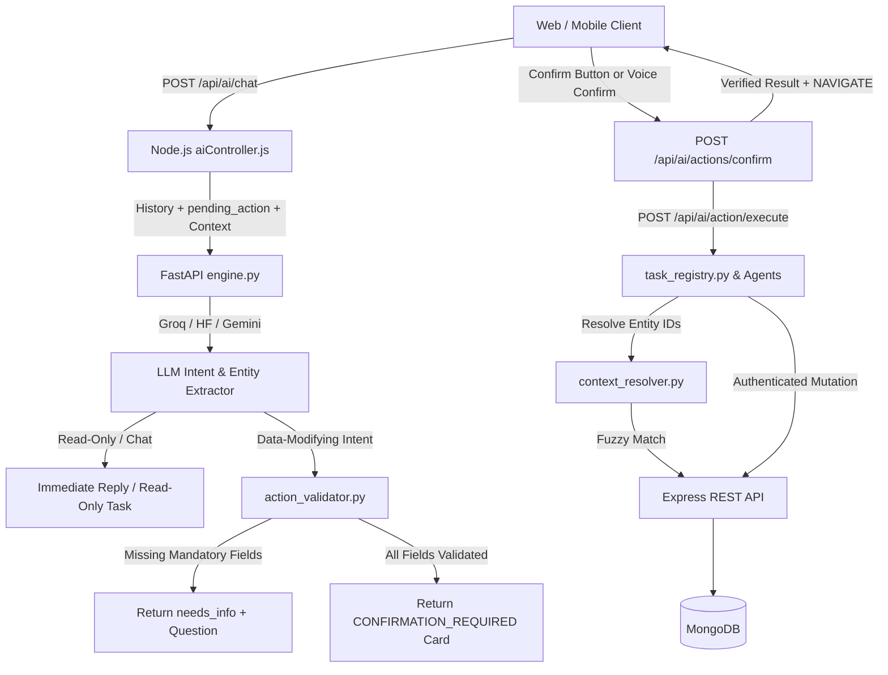

# Complete Agentic AI Architecture Overview

This document outlines the architecture and end-to-end data flow for the **GramSathi AI** system (`ai/`), which orchestrates user operations across Crops, Expenses, Market, Machinery, Messenger, Community, Workgroups, and Weather.

## System Architecture

1. **Backend Proxy & Session Persistence (`backend/routes/aiRoutes.js`, `backend/controllers/aiController.js`)**
   - Authenticates user via `fetchUser` (`auth-token`), loads `AIChat` session from MongoDB, and builds `user_context` (`backend/services/aiService.js`).
   - Maintains a token-aware context window (latest 15 messages in `history`, plus rolling `summary` and `context_facts`) alongside active `pending_action` state.
   - Proxies requests to FastAPI (`AI_SERVICE_URL` with local fallback candidates `127.0.0.1:8000` and `localhost:8000`).

2. **LLM Orchestration Engine (`ai/engines/engine.py`)**
   - Supports configurable providers (`GroqEngine` default via `qwen/qwen3.8-27b`, `HuggingFaceEngine`, or `GeminiEngine`).
   - Evaluates the incoming message alongside `history`, `pending_action`, `conversation_summary`, and `context_facts`.
   - Routes into 27 registered task intents (`TASK_REGISTRY`), 3 conversational intents (`GREETING`, `GENERAL_CONVERSATION`, `CHAT`), and 3 Human-in-the-Loop control intents (`CONFIRM_ACTION`, `CANCEL_ACTION`, `UPDATE_ACTION_PARAMS`).

3. **Human-in-the-Loop Validation Gate (`ai/core/action_validator.py`)**
   - Read-only / navigation intents (`NAVIGATE`, `WEATHER_GET`, `MACHINERY_SEARCH`, `CROP_OPEN`, etc.) execute immediately.
   - Data-modifying intents (`CROP_ADD`, `CROP_ADD_EXPENSE`, `CROP_SELL`, `MACHINERY_BOOK`, etc.) are validated against mandatory field schemas and normalized (including relative Telugu/Hindi/English dates and numeric units).
   - Missing fields trigger `status: "needs_info"` and a localized clarification prompt while preserving already-extracted slots.
   - Complete fields generate a `CONFIRMATION_REQUIRED` card (`status: "pending_confirmation"`) and wait for explicit farmer confirmation (`POST /api/ai/actions/confirm` or conversational confirm) or cancellation (`POST /api/ai/actions/cancel`).

4. **Task Registry (`ai/core/task_registry.py`) & Modular Agents (`ai/core/agents/`)**
   - Maps verified intents to domain agents (`crop_agent.py`, `expense_agent.py`, `machinery_agent.py`, `messenger_agent.py`, `community_agent.py`, `market_agent.py`, `weather_agent.py`, `group_agent.py`).
   - Executes only after confirmation (or immediately for read-only actions).

5. **Shared Context Resolver (`ai/core/context_resolver.py` & `ai/core/smart_matcher.py`)**
   - Resolves human entity names (e.g., crop `"Paddy"` for `CROP_ADD_EXPENSE`, recipient `"Ramesh"` for `MESSENGER_SEND`) against live backend APIs using `difflib.SequenceMatcher` (90% threshold) and disambiguation prompts when multiple matches occur.

6. **Express Backend Execution (`backend/controllers/`)**
   - Receives authorized REST calls from `ai/core/api_client.py` using the user's `auth-token`.
   - Persists mutations in MongoDB (`CropCycle`, `Booking`, `Post`, `Message`, `WorkGroup`, etc.) and returns verified results plus optional frontend navigation actions (`NAVIGATE` / `REFRESH_UI`).

## Flow Diagram

